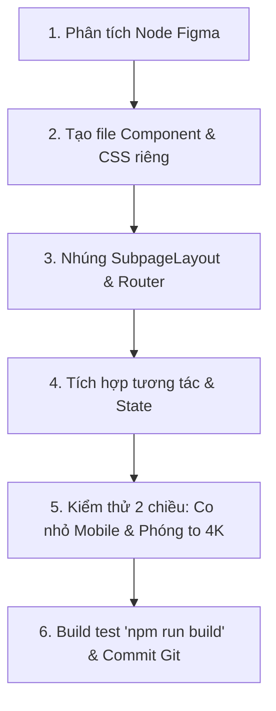

# HƯỚNG DẪN DÀNH CHO AGENT: TÁI TẠO & PHÁT TRIỂN WEB TỪ THIẾT KẾ FIGMA SANG REACT + VITE
> **Tài liệu quy chuẩn kỹ thuật, kinh nghiệm và nguyên tắc bắt buộc khi chuyển đổi giao diện Figma sang Website Single Page Application (SPA) chuẩn React + Vite.**

---

## MỤC LỤC
1. [Triết Lý Cốt Lõi (Core Principles)](#1-triết-lý-cốt-lõi-core-principles)
2. [Cấu Trúc Thư Mục Dự Án Chuẩn React + Vite (Project Architecture)](#2-cấu-trúc-thư-mục-dự-án-chuẩn-react--vite-project-architecture)
3. [Quy Trình Chuyển Đổi Từng Trang Từng Bước (Step-by-Step React Workflow)](#3-quy-trình-chuyển-đổi-từng-trang-từng-bước-step-by-step-react-workflow)
4. [Quy Chuẩn Responsive Đa Màn Hình: Co Nhỏ (Mobile) & Phóng To (4K / Màn Hình Lớn)](#4-quy-chuẩn-responsive-đa-màn-hình-co-nhỏ-mobile--phóng-to-4k--màn-hình-lớn)
5. [Kỹ Thuật Responsive Fluid-First & Xử Lý Tràn Viền](#5-kỹ-thuật-responsive-fluid-first--xử-lý-tràn-viền)
6. [Khai Thác & Xử Lý Assets (Tránh Cạm Bẫy Cắt Cúp)](#6-khai-thác--xử-lý-assets-tránh-cạm-bẫy-cắt-cúp)
7. [Typography, Màu Sắc & Ngôn Ngữ Tiếng Việt](#7-typography-màu-sắc--ngôn-ngữ-tiếng-việt)
8. [Tương Tác, Hiệu Ứng Chuyển Trang & Video Player](#8-tương-tác-hiệu-ứng-chuyển-trang--video-player)
9. [Checklist Kiểm Thử Trước Khi Bàn Giao](#9-checklist-kiểm-thử-trước-khi-bàn-giao)

---

## 1. TRIẾT LÝ CỐT LÕI (CORE PRINCIPLES)

1. **Bám sát Figma tuyệt đối (Source of Truth)**:
   - Không tự ý bịa đặt kích thước, màu sắc, font chữ hoặc cấu trúc thành phần.
   - Luôn sử dụng công cụ MCP (`figma_execute`, `figma_get_component_for_development`, `figma.getNodeByIdAsync`) hoặc phân tích file JSON xuất từ Figma API để lấy tọa độ và thông số chính xác.
2. **Kiến trúc SPA hiện đại (Vite + React)**:
   - Toàn bộ website vận hành dưới dạng Single Page Application (SPA).
   - Chuyển trang tức thì 0ms, không tải lại trang HTML, mượt mà với `framer-motion` cross-fade.
   - Không dùng máy chủ MPA cũ hay file HTML con phân tán. Thư mục `public/assets/` chỉ lưu trữ media thuần túy.
3. **Quy tắc F5 hoặc Khởi động mới (Session Reset)**:
   - Khi người dùng tải lại trang (F5) hoặc mở tab mới trực tiếp vào URL nhánh con, ứng dụng luôn tự động điều hướng về lại Trang Chủ (`/`) để giữ nguyên trải nghiệm nghệ thuật mở đầu.
4. **Không để tràn viền màn hình (Zero Horizontal Scroll)**:
   - Tuyệt đối không xuất hiện thanh cuộn ngang ở bất kỳ dải màn hình nào từ Mobile ($375\text{px}$) đến màn hình siêu rộng 4K ($2560\text{px}+$ và $3840\text{px}$).

---

## 2. CẤU TRÚC THƯ MỤC DỰ ÁN CHUẨN REACT + VITE (PROJECT ARCHITECTURE)

```
project-root/
│
├── package.json               # Dependencies: react, react-dom, react-router-dom, framer-motion, vite
├── vite.config.js             # Cấu hình cổng (ví dụ: port 5177), plugin React & static preview
├── index.html                 # Entrypoint duy nhất của trình duyệt: chứa <div id="root"> & nạp main.jsx
├── AGENTS.md                  # Cẩm nang quy chuẩn kỹ thuật cho Agent
│
├── public/                    # Kho chứa tài nguyên tĩnh thuần túy (Static Assets)
│   └── assets/                # Không chứa bất kỳ file HTML nào ở đây
│       ├── home/              # Vector, cutout trang chủ
│       ├── music/             # Poster, ảnh biểu diễn
│       ├── photography/       # Ảnh chụp các album
│       ├── filmmaking/        # Poster phim
│       ├── dance/             # Ảnh & poster biểu diễn
│       ├── art/               # Cutout thời trang, tranh vẽ
│       └── community/         # Ảnh hoạt động xã hội
│
└── src/                       # Mã nguồn ứng dụng React SPA
    ├── main.jsx               # Khởi tạo React root và BrowserRouter
    ├── index.css              # Reset CSS toàn cục, biến màu và font chữ chung
    ├── App.jsx                # Router trung tâm, logic F5 về Home, hiệu ứng AnimatePresence
    │
    ├── components/            # Các thành phần giao diện tái sử dụng
    │   ├── SidebarNav.jsx     # Menu điều hướng bên trái (active state tự động)
    │   ├── SidebarNav.css     
    │   ├── SubpageLayout.jsx  # Khung bao canvas chung thích ứng mọi màn hình
    │   ├── SubpageLayout.css  
    │   ├── VideoBox.jsx       # Trình phát video YouTube lazy-load click-to-play
    │   └── VideoBox.css       
    │
    └── pages/                 # Các trang và phân hệ giao diện độc lập
        ├── Home.jsx           # Trang chủ (vector chữ ký, 3 hotspot tương tác Áo/Váy/Cà vạt, popup)
        ├── Home.css           
        ├── Music.jsx          # Trang âm nhạc (Piano, nhạc cụ truyền thống, concert cân bằng 50-50)
        ├── Music.css          
        ├── Filmmaking.jsx     # Trang phim ảnh (4 hàng phim 2 cột)
        ├── Filmmaking.css     
        ├── DancePerformance.jsx # Trang vũ đạo & biểu diễn
        ├── DancePerformance.css 
        ├── Art.jsx            # Trang nghệ thuật & thời trang (collage cutout 7 dáng, tranh 3D)
        ├── Art.css            
        ├── Community.jsx      # Trang hoạt động cộng đồng (5 dự án xã hội)
        ├── Community.css      
        │
        └── photography/       # Phân hệ album ảnh con
            ├── Flowers.jsx    # Album hoa (carousel 2 ảnh vô hạn + phím mũi tên)
            ├── Flowers.css    
            ├── Portrait.jsx   # Album chân dung (capsule tabs: photoshoot 1 & 2)
            ├── Portrait.css   
            ├── StreetPhotography.jsx # Album đường phố (carousel 4 ảnh)
            └── StreetPhotography.css
```

---

## 3. QUY TRÌNH CHUYỂN ĐỔI TỪNG TRANG TỪNG BƯỚC (STEP-BY-STEP REACT WORKFLOW)

Khi bắt đầu một trang mới trong dự án React, Agent **BẮT BUỘC** thực hiện tuần tự:



### Bước 1: Khởi tạo Component & CSS riêng biệt
- Mỗi trang có một cặp file song hành: `[PageName].jsx` và `[PageName].css`.
- Tất cả CSS của trang phải được đóng khung theo class bao bọc (scoped prefix), ví dụ `.filmmaking-page .page-title`, tránh đè chéo CSS sang các trang khác.

### Bước 2: Bọc trong `SubpageLayout`
Tất cả các trang con đều được bọc bên trong `<SubpageLayout>`:
```jsx
import React from 'react';
import SubpageLayout from '../components/SubpageLayout';
import './Filmmaking.css';

export default function Filmmaking() {
  return (
    <SubpageLayout>
      <div className="filmmaking-page">
        {/* Nội dung trang */}
      </div>
    </SubpageLayout>
  );
}
```

### Bước 3: Đăng ký Tuyến Đường tại `src/App.jsx`
- Đưa trang vào hệ thống `<Routes>` được bọc bởi `<PageTransition>` (`framer-motion`):
```jsx
<Route
  path="/filmmaking"
  element={
    <PageTransition>
      <Filmmaking />
    </PageTransition>
  }
/>
```

---

## 4. QUY CHUẨN RESPONSIVE ĐA MÀN HÌNH: CO NHỎ (MOBILE) & PHÓNG TO (4K / MÀN HÌNH LỚN)

> [!IMPORTANT]
> **Quy chuẩn 2 chiều bắt buộc**: Giao diện không chỉ cần co nhỏ đẹp mắt trên Mobile ($375\text{px} - 600\text{px}$), mà còn **phải tự động mở rộng tương xứng trên màn hình lớn ($1920\text{px}$ Full HD, $2560\text{px}$ 2K và $3840\text{px}$ 4K)**. Tuyệt đối không được "bỏ tù" nội dung trong một chiếc hộp cố định $1440\text{px}$ với hai khoảng trắng viền khổng lồ hai bên khi xem trên màn hình lớn!

### 4.1. Công thức Canvas co giãn linh hoạt 2 chiều
Thay vì đặt `max-width: 1440px;` cố định, sử dụng hàm `clamp()` thích ứng:
```css
/* SubpageLayout.css */
.subpage-canvas {
  position: relative;
  width: 100%;
  /* Co giãn từ tối thiểu 1440px trên laptop đến 2560px trên 4K */
  max-width: clamp(1440px, 88vw, 2560px);
  min-height: 100vh;
  margin: 0 auto;
  background-color: #FDF6E6;
  padding: clamp(30.11px, 2.5vw, 60px) clamp(50px, 5.2vw, 140px) clamp(56.2px, 4vw, 100px);
  display: flex;
}

.main-content {
  flex: 1 1 0;
  min-width: 0;
  width: 100%;
  max-width: 100%;
  margin-left: clamp(25px, 2.6vw, 65px);
}
```

### 4.2. Bảng quy đổi thông số Fluid Typography & Spacing:

| Thành phần | Mobile ($\le 600\text{px}$) | Desktop Chuẩn ($1440\text{px}$) | Màn hình lớn ($1920\text{px} - 4\text{K}$) | Công thức CSS `clamp()` chuẩn |
| :--- | :--- | :--- | :--- | :--- |
| **Tiêu đề lớn drop-cap** | $64\text{px}$ | $97.5\text{px}$ | $140\text{px} - 160\text{px}$ | `font-size: clamp(64px, 6.8vw, 160px);` |
| **Tiêu đề trang (Heading 1)**| $28\text{px}$ | $45\text{px}$ | $65\text{px} - 72\text{px}$ | `font-size: clamp(28px, 3.15vw, 72px);` |
| **Tiêu đề mục (Heading 2)** | $16\text{px}$ | $18\text{px}$ | $24\text{px} - 28\text{px}$ | `font-size: clamp(16px, 1.25vw, 28px);` |
| **Văn bản nội dung (Body)** | $13.5\text{px}$ | $13.5\text{px}$ | $18\text{px} - 20\text{px}$ | `font-size: clamp(13.5px, 0.95vw, 20px);` |
| **Line-height** | $16.5\text{px}$ | $16.5\text{px}$ | $24\text{px} - 26\text{px}$ | `line-height: clamp(16.5px, 1.2vw, 26px);` |
| **Chú thích (Caption)** | $10\text{px}$ | $12\text{px}$ | $16\text{px} - 18\text{px}$ | `font-size: clamp(10px, 0.85vw, 18px);` |
| **Nút bấm / Capsule** | $12\text{px}$ | $13.5\text{px}$ | $18\text{px}$ | `font-size: clamp(12px, 0.94vw, 18px);` |

---

## 5. KỸ THUẬT RESPONSIVE FLUID-FIRST & XỬ LÝ TRÀN VIỀN

> [!CAUTION]
> **Quy tắc vàng**: Khi cửa sổ trình duyệt co lại, các thành phần và ảnh **BẮT BUỘC PHẢI CO NHỎ LẠI TRƯỚC (RESIZE TRƯỚC)**, tuyệt đối không được nhô ra ngoài mép màn hình. Chỉ khi thu nhỏ đến ngưỡng giới hạn ($\le 600\text{px}$) mới chuyển sang xếp dọc (Stack/Wrap).

### 5.1. Bắt buộc có `min-width: 0` trên Flexbox & Grid
Mặc định thẻ flex-item và grid-item có `min-width: auto`. Với thẻ ``, nó sẽ giữ kích thước pixel thật của ảnh và từ chối co nhỏ lại, gây tràn màn hình:
```css
/* Luôn áp dụng trên toàn bộ container và các item con */
.grid-container > *, 
.flex-row > *,
.film-row > *,
.music-row > * {
  min-width: 0;
}

img {
  width: 100%;
  height: auto;
  object-fit: cover;
  display: block;
  min-width: 0;
}
```

### 5.2. Nguyên tắc cân bằng lưới Video / Ảnh đôi (50-50 Equal Bottoms)
Khi thiết kế có 2 khối video/ảnh nằm cạnh nhau:
- **Tuyệt đối không dùng pixel cứng hoặc tỉ lệ lệch**: Cả hai khối phải dùng `grid-template-columns: 1fr 1fr;` và cùng chung `aspect-ratio: 16 / 9`.
- Điều này đảm bảo mép đáy video và các dòng caption bên dưới luôn thẳng tắp và bằng nhau tuyệt đối.
```css
.row-dual-videos {
  display: grid;
  grid-template-columns: 1fr 1fr;
  gap: clamp(8px, 1.2vw, 18px);
  width: 100%;
  max-width: 100%;
}

.row-dual-videos .video-box {
  width: 100%;
  aspect-ratio: 16 / 9;
}
```

### 5.3. Hệ thống phân tầng ngắt dòng (Responsive Breakpoints):
1. **Desktop & Màn hình lớn ($> 880\text{px}$)**:
   - Sidebar nằm cố định bên trái ($180\text{px}$).
   - Tất cả hàng 2 cột, 3 cột, video song song giữ nguyên bố cục chuẩn Figma.
   - Các khối tự động co giãn theo tỷ lệ `clamp()`, không giật khung hình.
2. **Tablet ($680\text{px} - 880\text{px}$)**:
   - Sidebar chuyển lên đầu trang thành hàng ngang (`flex-wrap: wrap`), mở rộng 100% không gian cho nội dung chính.
   - Nhờ đó các lưới 2 và 3 ảnh vẫn duy trì hàng ngang tuyệt đẹp mà không bị chật chội.
3. **Mobile ($\le 600\text{px} - 680\text{px}$)**:
   - Chuyển `grid-template-columns: 1fr;` hoặc `flex-direction: column;` để nội dung xếp chồng theo chiều dọc, tối ưu cho thao tác vuốt chạm.

---

## 6. KHAI THÁC & XỬ LÝ ASSETS (TRÁNH CẠM BẪY CẮT CÚP)

- **Xuất ảnh trực tiếp từ Node Rectangle**: Trong Figma, designer thường dùng công cụ Crop (`scaleMode: 'CROP'`) để căn chỉnh chủ thể vào khung. Tuyệt đối không lấy ảnh gốc chưa crop qua API URL thông thường vì sẽ làm sai góc máy.
- **Tất cả Assets tĩnh lưu trữ tại `public/assets/`**:
  - Truy cập trong mã nguồn React bằng đường dẫn tuyệt đối bắt đầu từ gốc: `/assets/photography/...`, `/assets/music/...`.
  - Vite sẽ tự động phân phối các file này mà không qua quá trình biên dịch lại, đảm bảo tốc độ tải tối đa.

---

## 7. TYPOGRAPHY, MÀU SẮC & NGÔN NGỮ TIẾNG VIỆT

1. **Bảng màu chủ đạo (Color Palette)**:
   - Nền toàn trang: `#FDF6E6` (Màu be ấm)
   - Chữ ký & Điểm nhấn chính: `#A53C5E` / `#B97278`
   - Màu cam đất caption & trích dẫn: `#CD6E49`
   - Màu văn bản chính: `#585858`
   - Màu menu chưa active: `#BEBEBE`
2. **Typography chuẩn tiếng Việt**:
   - `Libre Caslon Text`: Dành cho văn bản nội dung, tiêu đề mục, menu và caption.
   - `Pinyon Script`: Dành riêng cho chữ ký nghệ thuật và các chữ cái drop-caps mở đầu (`C`, `F`, `A`, `P`, `D`, `&`).
   - Khai báo `<meta charset="UTF-8">` tại `index.html` để đảm bảo hiển thị trọn vẹn dấu tiếng Việt.

---

## 8. TƯƠNG TÁC, HIỆU ỨNG CHUYỂN TRANG & VIDEO PLAYER

### 8.1. Hiệu ứng chuyển trang mượt mà với `framer-motion`
Sử dụng component bao bọc `<PageTransition>` cho từng Route:
```jsx
function PageTransition({ children }) {
  return (
    <motion.div
      initial={{ opacity: 0 }}
      animate={{ opacity: 1 }}
      exit={{ opacity: 0 }}
      transition={{ duration: 0.22, ease: [0.4, 0, 0.2, 1] }}
      style={{ width: '100%', minHeight: '100vh' }}
    >
      {children}
    </motion.div>
  );
}
```

### 8.2. Component Video YouTube tối ưu (`VideoBox`)
- Chỉ tải thẻ `<iframe>` khi người dùng thực sự click vào video (`isPlaying: true`), giúp trang web tải siêu nhanh và tiết kiệm băng thông.
- Các tham số URL chuẩn để ẩn quảng cáo ngoài và giữ giao diện sạch sẽ:
  `autoplay=1&controls=0&modestbranding=1&rel=0&iv_load_policy=3&playsinline=1`.

### 8.3. Điều hướng Album ảnh
- Mũi tên điều hướng nằm chuẩn mép trong ảnh với nền bóng mờ gradient.
- Luôn hỗ trợ vòng lặp vô hạn (Infinite Looping: từ ảnh cuối quay lại ảnh đầu).
- Luôn gắn sự kiện bàn phím `ArrowLeft` và `ArrowRight` để người dùng có thể lật ảnh bằng bàn phím.

---

## 9. CHECKLIST KIỂM THỬ TRƯỚC KHI BÀN GIAO

Mỗi khi phát triển hoặc cập nhật bất kỳ trang nào, Agent **BẮT BUỘC** phải tự kiểm tra:

- [ ] **Kiểm thử đa dải độ phân giải**:
  - `4K / 2560px`: Canvas co giãn cân đối, không có khoảng viền trống thừa dị thường.
  - `1920px Full HD`: Nội dung căng tràn tự nhiên, font chữ lớn rõ nét.
  - `1440px / 1200px Laptop`: Khớp 100% Figma, không trồi mép.
  - `768px Tablet`: Menu chuyển thành hàng ngang ở trên cùng, các khối co giãn mượt mà.
  - `375px - 420px Mobile`: Các khối xếp dọc, hình ảnh và video không bị tràn ngang.
- [ ] **Không xuất hiện thanh cuộn ngang (Zero Horizontal Scroll)** ở tất cả các kích thước.
- [ ] **Quy tắc F5 / Reload**: Tải lại trang ở bất kỳ nhánh con nào cũng tự động đưa về Home `/`.
- [ ] **Chuyển trang 0ms**: Menu sidebar và các link thẻ card chuyển trang êm ái với hiệu ứng cross-fade.
- [ ] **Tương tác**: Các video click-to-play phát chuẩn, carousel ảnh lật bằng phím bấm và nút chuột mượt mà.
- [ ] **Biên dịch Production**: Lệnh `npm run build` hoàn thành với kết quả 0 lỗi, 0 cảnh báo.
